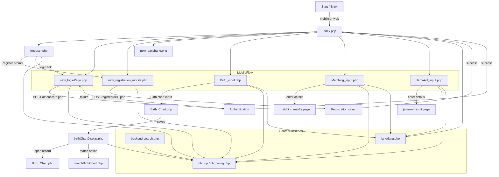

# DSJV Website Architecture Overview

## High-Level Components

- **Client Browser**
  - Desktop and mobile users
  - Uses cookies, form submissions, and AJAX search requests
- **PHP Frontend Router**
  - `index.php` is the main landing page and routing entrypoint
  - Determines user type and redirects to feature modules
- **Feature Modules**
  - `new_panchang.php` — Panchang / daily astrology details
  - `Birth_input.php` — Birth chart input and history
  - `Matching_input.php` — Compatibility matching
  - `Jamakol_input.php` — Jamakol-specific input flows
  - `freeuser.php` — Default page for free/anonymous users
- **Shared Backend Services**
  - `db.php` / `db_config.php` — MySQL connection and helpers
  - `lib.php` — application constants, session helpers, translation helpers
  - `lang/lang.php` + language files — multi-language support for Tamil/English
  - `backend-search.php` and search helpers — location search autocomplete
  - `sweph/` library — Swiss Ephemeris for astrology calculations
- **Static Assets**
  - `css/` stylesheets for layout and chart display
  - `common.js`, `script.js` — shared client-side logic and UI interactions
  - External libraries: jQuery, Hammer.js, Font Awesome
- **Database**
  - `dsjv` MySQL database
  - Tables include user records, charts, announcements, world cities, activity log, etc.

## High-Level Architecture Diagram

````mermaid
flowchart TD
    Browser[Client Browser]
    subgraph Frontend
      Index[index.php]
    end
    subgraph AuthRouter
      AuthLogic[User/Cookie Detection]
      Route[Redirect to Feature Module]
    end
    subgraph Features
      Panchang[new_panchang.php]
      Birth[Birth_input.php]
      Matching[Matching_input.php]
      Jamakol[Jamakol_input.php]
      FreeUser[freeuser.php]
    end
    subgraph SharedBackend
      DB[db.php / db_config.php]
      Lib[lib.php]
      Lang[lang/lang.php + locale files]
      Search[backend-search.php]
      Ephemeris[sweph/ Swiss Ephemeris]
    end
    subgraph Assets
      CSS[css/*.css]
      JS[common.js / script.js]
      External[External libs: jQuery, Hammer.js]
    end
    Database[(MySQL dsjv)]

    Browser --> Index
    Index --> AuthLogic
    AuthLogic --> Route
    Route --> Panchang
    Route --> Birth
    Route --> Matching
    Route --> Jamakol
    Route --> FreeUser
    Panchang --> DB
    Birth --> DB
    Matching --> DB
    Jamakol --> DB
    FreeUser --> DB
    Panchang --> Lang
    Birth --> Lang
    Matching --> Lang
    Jamakol --> Lang
    FreeUser --> Lang
    Panchang --> Search
    Matching --> Search
    Panchang --> Ephemeris
    Birth --> Ephemeris
    Matching --> Ephemeris
    Jamakol --> Ephemeris
    Browser --> CSS
    Browser --> JS
    Browser --> External
    DB --> Database
```

## Notes

- `index.php` sets the initial session/cookie state and routes users by `user_type` constants.
- The site supports both mobile-specific and web-specific login flows.
- Many pages use a shared language engine and search-autocomplete.
- Astrology calculations rely on Swiss Ephemeris binaries under `sweph/`.

## Page-Level Navigation Flow



## Recommended Next Step

If you want, I can also map the database tables to these pages for a complete data flow diagram.
